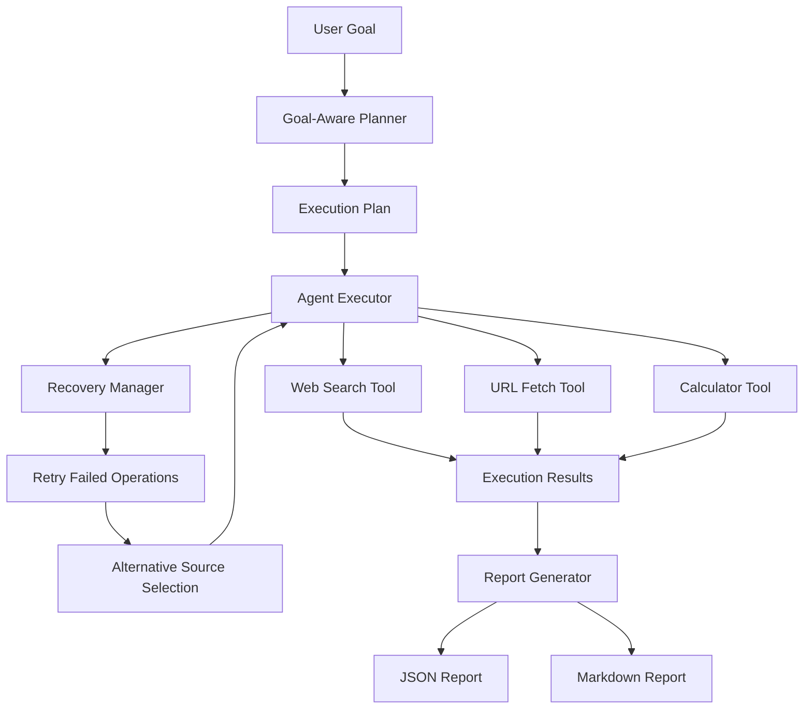

# Agentic Research and Decision Agent

## Architecture

## Main Components

1. Planner: Identifies the user's goal and creates an execution plan.
2. Executor: Executes planned tasks using available tools.
3. Web Search: Finds relevant online information.
4. URL Fetcher: Extracts readable webpage content.
5. Calculator: Evaluates mathematical expressions safely.
6. Recovery Manager: Handles failures through retries and alternative sources.
7. Report Generator: Produces structured JSON and Markdown reports.

## Planning Approach

The current planner uses local keyword-based rules. It does not require an external LLM API.

## Failure Handling

The system records failed attempts, retries operations, and moves to alternative sources when a website remains unavailable.
